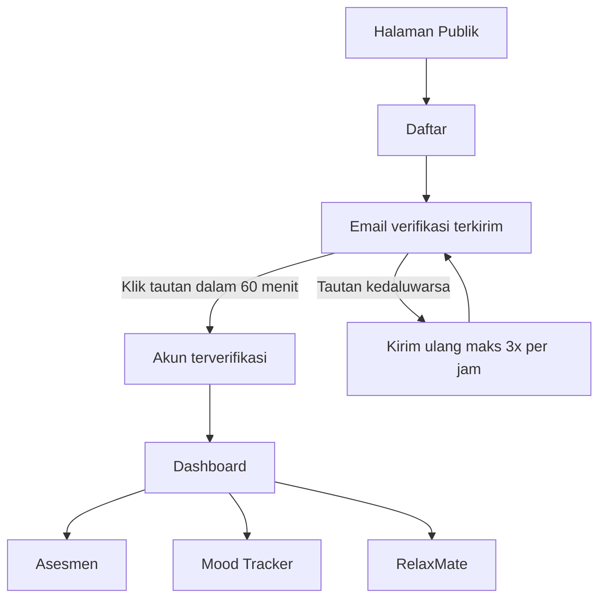
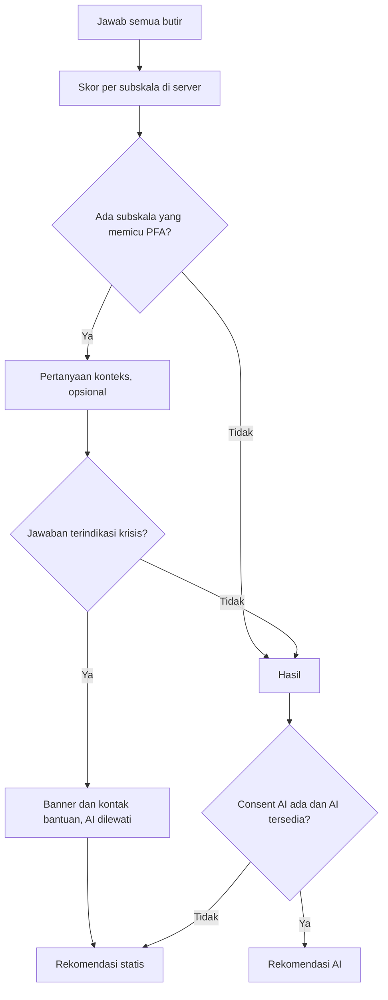
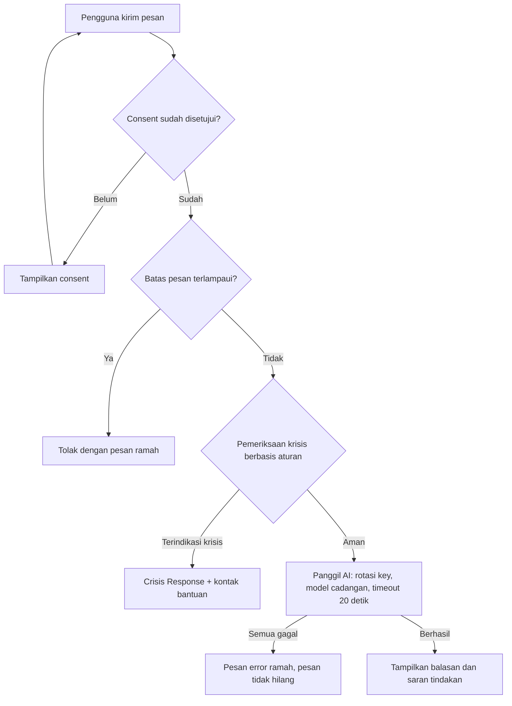

# RelaxBoss - PRD
Version: 1.9 | Status: Draft | Last updated: 2026-11-06
Owner: Founder (solo developer)

Label klaim: `[Verified]` = ada sumber yang dicek, `[Inference]` = kesimpulan dari konteks, `[Assumption]` = asumsi yang bisa diubah. Kedalaman: **Lite**.

---

## 1. Overview

**Masalah.** Mahasiswa di Indonesia mengalami stres, kecemasan, dan burnout akademik, tetapi layanan profesional dianggap mahal, menimbulkan stigma, atau sulit diakses. Mereka butuh cara ringan untuk mengenali kondisi sendiri sebelum memutuskan mencari bantuan. `[Inference]`

**Visi.** "Kita yang mengendalikan stres, bukan sebaliknya." RelaxBoss membantu mahasiswa memahami kondisi mentalnya secara mandiri dan tetap menyediakan jalur ke profesional.

**Pitch satu kalimat.** RelaxBoss adalah platform web gratis untuk mengenali dan memantau kesehatan mental mahasiswa lewat Asesmen, Mood Tracker, dan RelaxMate (pendamping percakapan AI).

**Konteks proyek.** Satu produk untuk satu segmen (mahasiswa; siswa dan pekerja dihapus agar fokus), dibangun ulang dari nol oleh satu developer, berfungsi sebagai tugas akhir dan portofolio. Halaman Tentang juga menampilkan tim kolaborator dan pembimbing yang dikonfigurasi dengan izin. Backend yang sama dipakai aplikasi mobile Android lewat API `/api/v1` (FR-039); klien mobile dan kontrak API-nya dirinci di dokumen mobile terpisah (PRD-M, Architecture-M). Sisi portofolio tidak mengubah kewajiban keselamatan dan privasi.

---

## 2. Goals, Non-goals, Metrik

**Goals**
- G1: Mahasiswa dapat mengenali kondisinya lewat Asesmen yang hasilnya mudah dipahami.
- G2: Mahasiswa dapat melacak mood (boleh beberapa kali sehari) dan melihat polanya dalam grafik 7 dan 30 hari.
- G3: Mahasiswa punya teman bicara (RelaxMate) yang aman, dengan penanganan krisis yang jelas.
- G4: Produk dapat ditemukan lewat pencarian Google (SEO) dan Instagram.
- G5: Kode, README, dan case study layak dipamerkan sebagai portofolio (dokumen proyek internal disimpan di luar repo dan dapat dipublikasikan belakangan bila diinginkan).

**Non-goals (rilis ini)**
- Tidak melatih atau fine-tune model dalam rilis ini. Data hanya dapat **diekspor** (FR-030) dari pengguna yang menyetujui, untuk keperluan pelatihan di masa depan.
- Tidak memberi diagnosis atau menggantikan psikolog. Bukan perangkat medis.
- Tidak ada: segmen siswa dan pekerja, To-Do/Pomodoro, Program Komunitas, realtime/WebSocket, ekspor PDF/Excel, pembayaran, login Google. Klien mobile bukan bagian dokumen ini; web hanya menyediakan API-nya (FR-039).

**Metrik keberhasilan** (target `[Assumption]`, sesuaikan setelah ada baseline)

| ID | Metrik | Target | Cara ukur |
|---|---|---|---|
| M-1 | Aktivasi: akun baru menyelesaikan ≥1 Asesmen dalam 7 hari | ≥40% | Hitungan dari data (FR-025) |
| M-2 | Retensi: pengguna yang selesai Asesmen mencatat mood di ≥3 hari berbeda dalam 14 hari | ≥25% | Hitungan dari data |
| M-3 | Adopsi RelaxMate: pengguna aktif memulai Percakapan dalam 14 hari | ≥30% | Hitungan dari data |
| M-4 | Halaman Publik terindeks Google 60 hari setelah launch | ≥30 halaman `[Assumption]` | Google Search Console |
| M-5 | Keselamatan: pesan pada daftar uji krisis (≥30 kasus Bahasa Indonesia) yang memicu Crisis Response | 100% | Pemeriksaan manual sebelum push (RULE-047) |
| M-6 | Portofolio: README dan case study terbit saat launch | Ya | Cek manual |

---

## 3. Pengguna

| Persona | Konteks | Kebutuhan utama | Catatan aksesibilitas |
|---|---|---|---|
| Mahasiswa | Beban tugas, skripsi, hidup mandiri, persiapan karier | Memantau stres dan mood, bercerita, saran awal | Dominan HP dan laptop |
| Admin (founder; dapat menambah admin lain, FR-035) | Mengelola instrumen, artikel, pengumuman, dan memantau pemakaian | Kelola Asesmen, statistik, tinjauan kualitas tanpa identitas | Tidak membaca identitas pemilik data pribadi (FR-024, FR-031) |

Jurusan dipakai sebagai konteks percakapan RelaxMate (FR-015); kampus hanya profil.

---

## 4. Scope (MoSCoW)

| Prioritas | Item |
|---|---|
| **Must** | Registrasi, verifikasi email, login, reset sandi; Asesmen (kerjakan, skor per subskala, hasil, PFA, riwayat); Mood Tracker; RelaxMate dengan consent dan Crisis Response; profil, ganti sandi, dan hapus akun; Halaman Publik + SEO dasar; keterkaitan UMB dan jalur konsultasi (sesuai yang terkonfirmasi); admin (kelola Asesmen, pengguna, statistik, monitoring tanpa identitas) |
| **Should** | Rekomendasi AI di hasil Asesmen; hitungan KPI; ekspor data AI dengan persetujuan; artikel edukasi Publik untuk SEO (FR-021); notifikasi dalam aplikasi dan pengumuman (FR-036 s.d. FR-038); API untuk klien mobile (FR-039) |
| **Could** | Mode gelap, ekspor data pribadi oleh pengguna, autentikasi dua langkah admin |
| **Won't (rilis ini)** | Antarmuka mobile di repo web (hanya API-nya, FR-039), login Google, To-Do/Pomodoro, Program Komunitas, realtime, ekspor PDF/Excel, pelatihan model, segmen siswa dan pekerja |

---

## 5. User Stories

| ID | Cerita | Acceptance Criteria |
|---|---|---|
| US-001 | Sebagai pengguna baru, saya mendaftar dan memverifikasi email agar akun saya aktif. | **Given** form valid **When** saya mendaftar **Then** email verifikasi terkirim dan saya belum bisa membuka fitur aplikasi sampai tautan diklik. |
| US-002 | Sebagai pengguna, saya login dan mereset sandi bila lupa. | **Given** akun terverifikasi **When** saya login benar **Then** masuk ke dashboard; **When** salah 5 kali dalam 1 menit **Then** percobaan ditolak sementara. |
| US-003 | Sebagai pengguna, saya mengerjakan Asesmen dan memahami hasilnya. | **Given** Asesmen aktif **When** saya menjawab semua butir **Then** skor, kategori per subskala, penjelasan, dan disclaimer "bukan diagnosis" tampil; bila ada subskala yang memicu PFA, saya diajak menjawab pertanyaan konteks (opsional). |
| US-004 | Sebagai pengguna, saya melihat riwayat Asesmen. | **Given** saya pernah mengerjakan Asesmen **When** membuka riwayat **Then** hasil terurut tanggal dan dapat dibuka ulang. |
| US-005 | Sebagai pengguna, saya mencatat mood dan melihat polanya. | **Given** saya membuka Mood Tracker **When** saya mengisi skala 1-5 (dan tenaga) **Then** entri tersimpan dan grafik 7 dan 30 hari diperbarui; saya boleh mencatat lebih dari sekali sehari sampai batas harian. |
| US-006 | Sebagai pengguna, saya bercerita ke RelaxMate. | **Given** consent disetujui **When** saya mengirim pesan **Then** balasan empatik tampil dan riwayat tersimpan; bila layanan AI gagal, pesan error ramah tampil dan pesan saya tidak hilang. |
| US-007 | Sebagai pengguna yang sedang krisis, saya diarahkan ke bantuan nyata. | **Given** pesan mengindikasikan menyakiti diri **When** terkirim **Then** Crisis Response dan kontak bantuan terverifikasi tampil. |
| US-008 | Sebagai calon pengguna, saya menemukan RelaxBoss lewat pencarian. | **Given** pencarian topik terkait **When** membuka Halaman Publik **Then** halaman memuat konten, title, dan meta unik serta dapat diindeks. |
| US-009 | Sebagai pengguna, saya menghapus akun dan seluruh data saya. | **Given** saya login **When** mengonfirmasi dengan kata sandi **Then** semua data pribadi saya terhapus permanen. |
| US-010 | Sebagai admin, saya mengelola Asesmen dan melihat statistik. | **Given** login sebagai admin **When** membuka panel **Then** saya dapat mengelola Asesmen dan melihat angka agregat. |
| US-011 | Sebagai admin, saya meninjau kualitas balasan RelaxMate dan rekomendasi AI tanpa melihat siapa pemiliknya. | **Given** login sebagai admin **When** membuka monitoring **Then** isi tampil tanpa identitas dan setiap pembukaan tercatat. |
| US-012 | Sebagai pengguna, saya memilih apakah data saya boleh dipakai melatih model di masa depan. | **Given** alur consent **When** saya memilih "Ya" atau "Tidak" **Then** pilihan tersimpan, tidak memengaruhi akses fitur, dan dapat saya ubah kapan saja. |
| US-013 | Sebagai calon pengguna, saya menemukan artikel edukasi lewat mesin pencari dan membacanya tanpa harus mendaftar. | **Given** artikel terbit **When** membuka `/artikel/{slug}` **Then** isi tampil lengkap dengan tanggal terbit, disclaimer edukasi, dan tautan ke Asesmen terkait bila ada; draf tidak dapat dibuka |

---

## 6. Functional Requirements

| ID | Requirement | Prioritas | Story |
|---|---|---|---|
| FR-001 | Pengguna MUST mendaftar dengan nama, email, kata sandi (min. 8 karakter); jurusan dan kampus opsional. Pengguna MUST mencentang pernyataan sudah membaca Ketentuan penggunaan dan Kebijakan privasi sebelum tombol Daftar aktif; centang divalidasi juga di server tetapi tidak disimpan (formalitas, bukan bukti persetujuan hukum). | Must | US-001 |
| FR-002 | Sistem MUST mengirim email verifikasi lewat SMTP mail hosting; tautan berlaku 60 menit; kirim ulang maks. 3 kali per jam. | Must | US-001 |
| FR-003 | Area Aplikasi MUST tidak dapat diakses sebelum email terverifikasi. | Must | US-001 |
| FR-004 | Pengguna MUST dapat login dan logout dengan email dan kata sandi; percobaan gagal dibatasi 5 kali per menit per kombinasi akun dan IP. | Must | US-002 |
| FR-005 | Pengguna MUST dapat mereset kata sandi lewat email. | Must | US-002 |
| FR-006 | Sistem MUST menampilkan katalog Asesmen aktif (nama, deskripsi, estimasi durasi). | Must | US-003 |
| FR-007 | Skor dihitung di server per subskala: nilai jawaban, pembalikan skor untuk butir terbalik, pengali skor Instrumen, lalu dicocokkan dengan aturan skoring. | Must | US-003 |
| FR-008 | Hasil MUST menampilkan skor dan interpretasi per subskala, penjelasan awam, disclaimer "bukan diagnosis", dan arahan konsultasi profesional. Subskala yang memicu PFA MUST menawarkan pertanyaan konteks (jawaban opsional). | Must | US-003 |
| FR-009 | Hasil MUST tersimpan dan riwayat dapat dilihat per tanggal. | Must | US-004 |
| FR-010 | Sistem SHOULD menampilkan Rekomendasi AI berdasarkan hasil dan konteks PFA, hanya bila pengguna sudah memberi consent AI; bila AI gagal, tanpa consent, atau jawaban PFA terindikasi krisis MUST menampilkan rekomendasi statis dari aturan skoring. Rekomendasi AI memakai prompt tersendiri (bukan prompt RelaxMate). | Should | US-003 |
| FR-011 | Pengguna MUST dapat mencatat Mood Entry (skala 1-5, tenaga "bertenaga" atau "lelah" opsional, catatan opsional maks. 500 karakter). Lebih dari satu entri per hari diperbolehkan, maks. 5 per hari (WIB). | Must | US-005 |
| FR-012 | Sistem MUST menampilkan grafik mood 7 dan 30 hari (satu titik per hari berupa rata-rata; hari tanpa entri berupa celah) dan, untuk 7 hari terakhir, wajah mood per hari. Rincian semua entri satu hari berjam tidak ditampilkan (`TODO-LATER.md`). | Must | US-005 |
| FR-013 | Sebelum memakai fitur AI pertama kali, pengguna MUST menyetujui consent AI (pesan dan jurusan diproses penyedia AI pihak ketiga, RelaxMate bukan layanan medis, pesan dapat ditinjau pengelola tanpa identitas) dan MUST memilih ya atau tidak untuk persetujuan pelatihan (tanpa nilai awal, penolakan tidak mengurangi akses). Pilihan dapat diubah di pengaturan akun. | Must | US-006, US-012 |
| FR-014 | Pengguna MUST dapat berbicara dengan RelaxMate; riwayat Percakapan tersimpan per pengguna. | Must | US-006 |
| FR-015 | Sistem MUST NOT mengirim nama, email, ID, atau kampus ke penyedia AI. Hanya isi percakapan dan jurusan (bila diisi) yang boleh dikirim. | Must | US-006 |
| FR-016 | Sistem MUST membatasi pemakaian RelaxMate maks. 20 pesan per hari (WIB) dan 5 pesan per menit per pengguna; kelebihan ditolak dengan pesan ramah. | Must | US-006 |
| FR-017 | Bila penyedia AI gagal atau melewati timeout 20 detik, RelaxMate MUST menampilkan pesan error ramah dan tidak menghilangkan pesan pengguna. | Must | US-006 |
| FR-018 | Pesan berisiko krisis MUST memicu Crisis Response: pesan empatik tetap, kontak bantuan terverifikasi, ajakan menghubungi orang terdekat atau profesional. Deteksi berlapis: aturan kata kunci sebelum memanggil AI, ditambah instruksi sistem pada AI. Banner bantuan tetap tampil selama Percakapan berlanjut. Pemeriksaan krisis berbasis aturan juga dijalankan pada jawaban PFA Asesmen; bila terdeteksi, jawaban tidak dikirim ke AI, hasil menampilkan banner dan kontak bantuan. | Must | US-007 |
| FR-019 | Pengguna MUST dapat menghapus akun; profil, hasil Asesmen, Mood Entry, dan Percakapan terhapus permanen setelah konfirmasi kata sandi. | Must | US-009 |
| FR-020 | Halaman Publik (beranda, info tiap Asesmen, Tentang, Konsultasi, Privasi, Ketentuan) MUST dirender di server (Blade) dengan title, meta description, dan canonical unik, plus `sitemap.xml` dan `robots.txt`. | Must | US-008 |
| FR-021 | Halaman Publik Artikel edukasi (`/artikel` dan `/artikel/{slug}`) MUST dirender di server (Blade) dengan title, meta description, dan canonical unik, dan masuk `sitemap.xml`. Hanya artikel berstatus terbit dengan tanggal terbit yang sudah lewat yang tampil; draf, terjadwal, dan artikel contoh `demo-` di produksi menghasilkan 404. Isi ditulis Markdown dan dirender tanpa HTML mentah. Artikel bersifat edukasi, tidak memberi diagnosis, dan tidak memuat klaim yang belum terkonfirmasi (RULE-049). Pengguna yang sudah masuk menemukan tautan ke halaman Artikel dari Dashboard; halaman artikel tetap konten Publik dan tidak masuk rail Area Aplikasi. Daftar artikel menyediakan pencarian judul dan kategori melalui `?q=`, serta paginasi bernomor. Halaman hasil pencarian memakai `noindex` dan canonical menuju daftar artikel. | Should | US-013 |
| FR-032 | Admin MUST dapat mengelola artikel edukasi (buat, ubah, simpan sebagai draf, terbitkan, jadwalkan, pratinjau Markdown). Artikel tidak dihapus; dikembalikan ke draf. Konten publik, tanpa data pengguna. | Should | US-013 |
| FR-033 | Pengguna MUST dapat melihat profilnya dan mengubah nama, jurusan, serta kampus dari halaman Akun (email tidak dapat diubah), dan memperbarui atau menghapus foto profil (JPG, PNG, atau WebP, maks. 2 MB). Foto diproses ulang menjadi JPEG persegi kecil, disimpan di disk privat, hanya disajikan kepada pemiliknya, dan ikut terhapus bersama akun (FR-019). Semua divalidasi di server. | Must | US-001 |
| FR-034 | Pengguna MUST dapat mengganti kata sandi dari halaman Akun dengan memasukkan kata sandi saat ini (percobaan dibatasi). Setelah berhasil, sesi di perangkat lain diakhiri. | Must | US-002 |
| FR-035 | Admin MUST dapat menambah akun admin baru (nama dan email) dari halaman Pengguna. Tidak ada kata sandi yang diketik: akun dibuat dengan sandi acak dan tautan atur sandi (60 menit, sekali pakai) dikirim ke email itu. Admin terakhir tidak dapat menghapus akunnya (FR-019). | Should | US-010 |
| FR-036 | Pengguna MUST dapat mengatur notifikasi dalam aplikasi secara opt-in: pengingat mood (jam WIB dibatasi 06.00–23.00) dan nudge (ajakan memakai Asesmen, RelaxMate, atau membaca artikel baru). Notifikasi hanya tampil di dalam aplikasi dan dihitung saat halaman dibuka (ADR-019), bukan dikirim lewat email atau web push; pengingat hanya memeriksa ada tidaknya entri mood, bukan isi catatan. | Should | US-001 |
| FR-037 | Lonceng notifikasi MUST berupa tautan ke halaman notifikasi dan menghitung pengumuman belum dibaca ditambah pengingat dan nudge yang tersedia. Pengguna dapat menandai pengumuman dibaca dan menutup nudge (sekali per hari). | Should | US-001, US-013 |
| FR-038 | Admin MUST dapat mengelola pengumuman pembaruan website (buat, ubah, draf, terbit, pratinjau Markdown). Pengumuman tidak dihapus; dikembalikan ke draf. Konten global tanpa data pengguna; dibaca semua pengguna di halaman notifikasi. | Should | US-010 |
| FR-039 | Sistem SHOULD menyediakan API `/api/v1` untuk klien mobile: daftar, masuk (token Sanctum per perangkat), keluar, lupa sandi, kirim ulang verifikasi, ringkasan akun (`/me`), konfigurasi publik (`/config`), teks dan status consent, kontak bantuan, serta pencatatan consent AI dan persetujuan pelatihan. Aturan bisnis, batas, dan teks sama dengan web; kontrak rinci ada di Architecture-M. Endpoint chat dan hapus akun menyusul di jalur mobile. | Should | US-001, US-006, US-012 |
| FR-022 | Halaman Tentang dan footer MUST menyebut keterkaitan dengan UMB dan Laboratorium Terapan Psikologi hanya sesuai yang sudah dikonfirmasi (OQ-2); halaman Konsultasi MUST memuat kontak yang valid. Bagian tim dan pembimbing hanya bersumber dari konfigurasi dan ditampilkan dengan izin; halaman Tentang memuat jejak acara yang diikuti RelaxBoss, hanya dari konfigurasi. | Must | US-008 |
| FR-023 | Admin MUST dapat mengelola Asesmen (Instrumen, butir, pilihan jawaban, pengali, aturan skoring, aktif atau nonaktif). | Must | US-010 |
| FR-024 | Admin MUST dapat melihat statistik agregat dan daftar pengguna terbatas (email, tanggal daftar, status verifikasi, aktif) serta menonaktifkan akun. Admin MUST NOT melihat catatan Mood Entry, jawaban Asesmen per butir, atau jawaban PFA, dan MUST NOT melihat identitas pemilik isi yang ditinjau di FR-031. | Must | US-010 |
| FR-025 | Sistem SHOULD menghitung KPI dari data yang ada, dan menyimpan hitungan tanpa isi untuk Crisis Response terpicu serta pemakaian AI harian per fitur (request, token, batas tercapai, galat). | Should | US-010 |
| FR-026 | Sistem MUST membatasi beban ke penyedia AI: pesan pengguna maks. 2.000 karakter; konteks maks. 10 pesan terakhir dan 9.000 karakter; keluaran maks. 800 token. | Must | US-006 |
| FR-027 | Bila model utama terkena batas pemakaian, sistem SHOULD beralih ke model cadangan sebelum menampilkan pesan error FR-017. | Should | US-006 |
| FR-028 | Panggilan AI memakai pool API key per fitur (`chat`, `assessment`) dengan rotasi, cooldown saat 429, penanganan key yang ditolak (401 atau 403), dan jatuh ke model cadangan lalu respons statis bila semua key terbatas. | Must | US-006 |
| FR-029 | Balasan RelaxMate disertai intent terdeteksi; sistem menampilkan saran tindakan berdasarkan prioritas intent (hotline untuk krisis, ajakan ke profesional, ajakan memakai fitur pendukung) dan mencatat tipe saran. | Must | US-006, US-007 |
| FR-030 | Sistem SHOULD menyediakan perintah ekspor data fitur AI (`chat`, `assessment`) yang dijalankan founder, hanya untuk pengguna yang menyetujui, tanpa identitas, dengan kerangka umum agar fitur AI baru mudah ditambahkan. | Should | US-012 |
| FR-031 | Admin MUST dapat meninjau (hanya baca) isi percakapan dan rekomendasi AI Asesmen tanpa identitas; setiap pembukaan MUST tercatat. | Must | US-011 |

Catatan: FR-021 dipakai untuk artikel edukasi. Nomor FR-033 sampai FR-039 mengikuti penanda di kode (FR-033 profil dan foto, FR-034 ganti sandi, FR-035 tambah admin, FR-036 s.d. FR-038 notifikasi dan pengumuman, FR-039 API mobile).

---

## 7. Non-Functional Requirements (ISO/IEC 25010)

| ID | Kualitas | Requirement | Target | Cara verifikasi |
|---|---|---|---|---|
| NFR-001 | Performa | Halaman Publik cepat dimuat di HP | LCP ≤ 2,5 detik (p75, mobile, throttling 4G) | Lighthouse / PageSpeed manual |
| NFR-002 | Performa | Balasan RelaxMate | p95 ≤ 8 detik; timeout 20 detik | Log durasi |
| NFR-003 | Keandalan | Kegagalan AI tidak menghilangkan data; uptime dipantau | Uptime ≥ 99% per bulan | Uptime monitor eksternal |
| NFR-004 | Keamanan | Sesuai OWASP Top 10: sandi di-hash, HTTPS saja, rate limit, otorisasi di server, tanpa secret di repo | 0 temuan Critical sebelum launch | Checklist OWASP manual |
| NFR-005 | Privasi | Isi sensitif (Mood Entry, jawaban Asesmen, Percakapan) terenkripsi di level aplikasi; admin hanya membaca isi tanpa identitas; tidak ada data pribadi di log | 0 PII di log | Pemeriksaan manual query admin dan log |
| NFR-006 | Aksesibilitas | WCAG 2.2 AA | Kontras teks ≥ 4,5:1; seluruh alur utama bisa lewat keyboard | axe + uji keyboard manual |
| NFR-007 | Kegunaan | Alur inti ringkas | Mood Entry selesai ≤ 3 klik dari dashboard | Uji manual |
| NFR-008 | Kompatibilitas | Peramban dan layar | 2 versi terakhir Chrome, Safari, Edge, Firefox; layar mulai 360 px | Uji manual |
| NFR-009 | Maintainability | Kode rapi dan dokumen terjaga | Gaya Pint dan ESLint dijalankan manual di lokal bila perlu; `npm run build` berhasil sebelum push; dokumen diperbarui di akhir task (Doc Sync) | Cek manual |
| NFR-010 | SEO | Halaman publik dapat diindeks | Lighthouse SEO ≥ 90 | Lighthouse manual |
| NFR-011 | Biaya | Rilis pertama tanpa biaya AI (free plan Groq) dan tetap berfungsi saat kuota habis | Biaya AI Rp0; hari dengan kuota habis ≤ 2 per minggu | `ai_usage_daily` |

---

## 8. Alur Utama dan Edge Case

**Alur onboarding**

**Alur Asesmen**

**Alur RelaxMate dan krisis**

**Edge case yang harus ditangani**
- Email sudah terdaftar saat registrasi (pesan validasi biasa, dibatasi rate limit; login dan reset sandi memakai pesan umum).
- Tautan verifikasi kedaluwarsa atau dipakai dua kali.
- Pengguna menutup Asesmen di tengah jalan (progres tidak disimpan; tampilkan peringatan sebelum keluar).
- Entri mood sekitar pergantian hari (tanggal mengikuti WIB); batas 5 entri per hari tercapai.
- Pesan kosong, sangat panjang, atau kirim ganda (dicegah oleh `turn_number` unik).
- Penyedia AI tidak tersedia, semua key terbatas, key ditolak (akun dicabut), atau model dihentikan.
- Pengguna menghapus akun saat Percakapan berlangsung.
- Pengguna menyebut krisis di luar RelaxMate, mis. di catatan mood (di luar cakupan deteksi; tautan bantuan permanen di footer area aplikasi).
- Balasan AI tidak berformat JSON yang diharapkan (pakai teks mentah, intent kosong).
- Jawaban PFA berisi isyarat krisis (jawaban disimpan terenkripsi, tidak dikirim ke AI, banner bantuan tampil).

---

## 9. Constraint, Dependensi, dan Kepatuhan

| Area | Isi | Label |
|---|---|---|
| Stack | Laravel 13, Inertia 3, React 19, Vite 8, Tailwind 4, shadcn, TypeScript; satu repo; detail di `Architecture.md` | `[Verified]` |
| Hosting | Shared hosting aktif di `https://relaxboss.my.id` (LiteSpeed, PHP 8.4 di server, lockfile dikunci 8.3, SSH tersedia); tanpa proses permanen. Sisa langkah go-live ada di `progress.md` (TASK-031) | Terverifikasi founder 2026-10-28 |
| Email | SMTP mail hosting; registrasi tidak batal bila email gagal, kirim ulang 3 per jam | Keputusan founder |
| Penyedia AI | Groq API. Model utama `openai/gpt-oss-120b`, cadangan `openai/gpt-oss-20b` (batas dihitung per model). Llama 3.3 70B Versatile dihentikan Groq per 2026-08-16 | Penghentian `[Verified]`; pilihan model ADR-004 |
| Kuota free plan | Contoh batas per model: 30 request/menit, 1.000 request/hari, 8.000 token/menit, 200.000 token/hari; berlaku per organisasi, bukan per key | `[Verified]` ringkasan pihak ketiga; halaman limits akun adalah acuan akhir |
| Rotasi banyak akun | Keputusan founder (2026-10-04): beberapa akun Groq, semuanya milik founder, dipakai bergantian per fitur. Ringkasan pihak ketiga atas Acceptable Use Policy Groq melarang menghindari batas lewat banyak akun, sehingga ada risiko akun diblokir; belum ada pemblokiran sampai sekarang (pengalaman, bukan jaminan kebijakan). Risiko diterima dengan mitigasi (R-9, ADR-009) | `[Inference]` (OQ-10) |
| Kepatuhan | Data kesehatan mental termasuk data sensitif. UU PDP (UU No. 27 Tahun 2022) kemungkinan mengatur data kesehatan sebagai data pribadi spesifik, persetujuan eksplisit, dan transfer lintas negara (server Groq di luar Indonesia). Pelatihan model dari data pengguna butuh persetujuan terpisah | `[Inference]`; verifikasi dengan ahli hukum atau komite etik kampus, bukan nasihat hukum |
| Kaitan akademik | Keterikatan dengan UMB dan Laboratorium Terapan Psikologi dipertahankan; klaim publik hanya yang sudah dikonfirmasi | OQ-2 |
| Data | Instrumen asli dan 25 artikel sudah dimasukkan; data dummy (akun `example.test`, Instrumen dan artikel `demo-`) tidak boleh ada di produksi (`relaxboss:preflight`); data lama (SQL) tidak diimpor | Keputusan founder |

---

## 10. Risiko dan Mitigasi

| ID | Risiko | Dampak | Mitigasi |
|---|---|---|---|
| R-1 | Klaim kolaborasi atau validasi psikolog tidak akurat | Reputasi, hukum | Konfirmasi tertulis (OQ-2); klaim publik hanya yang terkonfirmasi |
| R-2 | RelaxMate memberi respons berbahaya pada pengguna krisis | Keselamatan pengguna | FR-018, daftar kasus krisis M-5, disclaimer, tinjauan manual lewat monitoring admin |
| R-3 | Kebocoran data sensitif atau akses admin berlebihan | Privasi, hukum UU PDP | Enkripsi, FR-015, FR-024, FR-031 (tanpa identitas, tercatat), akun admin dengan sandi kuat |
| R-4 | Model AI dihentikan atau berubah | RelaxMate mati | `ChatCompletionClient` di balik interface; model dari `.env` |
| R-5 | Kuota Groq habis | RelaxMate sering menolak | Rotasi key, model cadangan, respons statis, pantau `ai_usage_daily`; pemicu upgrade di OQ-6 |
| R-6 | Batas shared hosting (timeout, email, versi PHP) | Fitur gagal di produksi | Request AI pendek dan ber-timeout; hosting diuji di TASK-031 |
| R-7 | Pola rewrite berulang | Proyek tidak selesai | Doc Sync; `TODO-LATER.md` untuk ide baru; satu task per waktu |
| R-8 | Pengguna tidak kembali setelah rilis | Produk sepi | Metrik M-1 sampai M-3; konten SEO dan Instagram |
| R-9 | Akun Groq diblokir karena rotasi banyak akun | Semua fitur AI mati | Aplikasi tetap hidup tanpa AI (respons statis); galat 401 dan 403 dicatat sebagai tanda dini; upgrade berbayar sebagai jalan keluar sah |
| R-10 | Data ekspor untuk pelatihan bocor atau dipakai tanpa dasar persetujuan | Privasi, hukum | Hanya pengguna `granted`, tanpa identitas, berkas non-publik, dihapus setelah dipakai; tinjauan manual sebelum pelatihan |
| R-11 | Akun admin adalah target bernilai | Akses ke isi tanpa identitas | Sandi kuat, rate limit login, admin baru memilih sandinya sendiri lewat tautan (FR-035); autentikasi dua langkah di daftar nanti |

---

## 11. Release Plan dan KPI

Tanggal `[Assumption]`. Status per 2026-11-06: M0 sampai M5 selesai; M6 berjalan (hosting aktif, sisa langkah go-live ada di `progress.md`).

| Milestone | Isi | Target | FR terkait |
|---|---|---|---|
| M0 | Dokumen v1.0 | 2026-10-07 | n/a |
| M1 | Fondasi, Auth, Halaman Publik dasar + SEO dasar | 2026-10-25 | FR-001 s.d. FR-005, FR-020, FR-022 |
| M2 | Asesmen | 2026-11-15 | FR-006 s.d. FR-010 |
| M3 | Mood Tracker dan Dashboard | 2026-11-29 | FR-011, FR-012 |
| M4 | RelaxMate, penanganan krisis, rotasi key, consent | 2026-12-20 | FR-010, FR-013 s.d. FR-018, FR-026 s.d. FR-029 |
| M5 | Hapus akun, admin, monitoring, ekspor, profil, notifikasi, pengumuman | 2027-01-10 | FR-019, FR-023 s.d. FR-025, FR-030 s.d. FR-038 |
| M6 | Audit, data nyata, artikel edukasi (FR-021), hosting, go-live, Search Console, Instagram, case study | 2027-01-17 | Semua |

**KPI yang diinstrumentasi:** akun terdaftar, akun terverifikasi, Asesmen selesai per jenis, Mood Entry dibuat, Percakapan dimulai, Crisis Response terpicu (hanya hitungan), pemakaian AI per fitur, klik dari Search Console.

---

## 12. Glosarium

| Istilah | Arti (dipakai persis sama di semua dokumen) |
|---|---|
| RelaxBoss | Nama platform dan produk |
| RelaxMate | Fitur chatbot pendamping percakapan berbasis AI |
| Asesmen | Rangkaian pertanyaan terstandar yang menghasilkan skor dan interpretasi per subskala |
| Instrumen | Satu jenis Asesmen beserta butir, pilihan jawaban, dan aturan skoringnya |
| Subskala | Dimensi pengukuran dalam satu Instrumen (mis. Depresi, Kecemasan, Stres) |
| PFA | Langkah pertanyaan konteks setelah hasil, dipicu subskala tertentu; jawabannya opsional |
| Mood Entry | Satu catatan mood (skala 1-5, tenaga, catatan opsional); satu hari boleh punya beberapa |
| Percakapan | Satu rangkaian pesan antara pengguna dan RelaxMate |
| Intent | Kategori maksud pesan pengguna yang dideteksi AI (17 kode) |
| Crisis Response | Respons khusus saat terdeteksi risiko menyakiti diri |
| Consent AI | Persetujuan sebelum memakai RelaxMate dan Rekomendasi AI |
| Persetujuan pelatihan | Pilihan terpisah apakah data boleh diekspor untuk pelatihan model |
| Halaman Publik | Halaman tanpa login, dirender server |
| Area Aplikasi | Halaman di balik login |
| Admin | Peran pengelola panel admin (satu orang) |
| UMB | Universitas Mercu Buana |

---

## 13. Referensi Pasar (ringkas)

- **Riliv** `[Verified]`: berdiri 2015; konseling online dengan psikolog, meditasi, konten self-care, layanan perusahaan. Klaim jumlah pengguna berbeda antar sumber, jadi angka tidak dipakai.
- **Pemain lain** (Satu Persen, Mindtera, dan sejenisnya): belum diverifikasi. Tidak ada klaim fitur pesaing di dokumen ini.
- **Diferensiasi** `[Inference]`: gratis dan ringan (tanpa unduh aplikasi), menggabungkan Asesmen, Mood Tracker, dan teman bicara AI dalam satu web untuk mahasiswa. Belum divalidasi ke pengguna; M-1 sampai M-3 menjadi cara memvalidasinya.

---

## Assumptions
- A-1: Pembaca dokumen adalah founder sebagai pengembang tunggal; dokumen disimpan di luar repo kode.
- A-2: Isi dokumen Bahasa Indonesia; ID, istilah teknis, dan kode tetap Inggris.
- A-3: Skala mood 1-5 (`sangat_sedih` sampai `luar_biasa`), batas 5 entri mood per hari, batas 20 pesan per hari dan 5 per menit, batas pesan 2.000 karakter, keluaran 800 token, dan semua target metrik adalah nilai awal yang bisa disesuaikan.
- A-4: Rilis pertama berisi Instrumen asli yang sumber dan izinnya jelas (OQ-1); Instrumen dapat dikelola admin tanpa kode (FR-023).
- A-5: Consent AI juga mencakup Rekomendasi AI di Asesmen (isi yang dikirim: hasil per subskala, konteks PFA, jurusan; tanpa identitas).
- A-6: Hosting mendukung PHP 8.3 dan SSH sesuai konfirmasi founder.
- A-7: Deteksi anomali intent versus mood tidak dibangun di rilis ini (`TODO-LATER.md`).

## Open Questions

| ID | Pertanyaan | Dibutuhkan sebelum | Status |
|---|---|---|---|
| OQ-1 | Sumber dan izin atau lisensi Instrumen asli (cari yang bebas dipakai); periksa perilaku skor terbalik MBI | TASK-030 | Terbuka; data dummy sampai saat itu |
| OQ-2 | Konfirmasi tertulis izin memakai nama/logo UMB, status Laboratorium Terapan Psikologi, serta nama/jabatan tim dan pembimbing | TASK-030 | Sebagian dikonfirmasi founder pada 2026-10-28: penyebutan acara, kolaborasi, dan nama UMB di halaman Tentang (`relaxboss.about`, `relaxboss.team`) boleh ditampilkan. Bentuk konfirmasi, izin logo, dan kontak Lab masih perlu dicatat; `relaxboss.umb` (bagian "Kaitan akademik" di Beranda) tetap kosong sampai klaim spesifik terverifikasi (RULE-049). |
| OQ-3 | Kontak bantuan krisis yang diverifikasi. Healing119.id (119 ext 8) sudah terisi dari sumber resmi; telepon sendiri untuk memastikan nomor aktif sebelum promosi. Kontak Laboratorium Terapan Psikologi hanya bila `PSYCH_LAB_HOTLINE_PHONE` terisi setelah OQ-2 | Sebelum promosi publik | Sebagian |
| OQ-5 | Kebijakan data Groq (retensi, pelatihan) dan UU PDP untuk transfer lintas negara dan pelatihan model; telaah ahli hukum atau komite etik | Sebelum persetujuan pelatihan dipakai nyata (TASK-030) | Terbuka |
| OQ-6 | Pemicu upgrade ke plan berbayar dan anggarannya | Setelah ada pengguna berarti | Ditunda |
| OQ-10 | Kebijakan Groq soal banyak akun | n/a | Risiko diterima oleh founder (R-9, ADR-009) |
| OQ-A1 | Versi database di hosting | TASK-031 | Terbuka; asumsi MySQL 8 tanpa fitur khusus versi |

**Ditutup:** OQ-4 (model AI, ADR-004), OQ-7 (skala mood 1-5), OQ-8 (batas email), OQ-9 (retensi cadangan 14 hari ditulis di halaman Privasi).

## Change Log

| Versi | Tanggal | Perubahan |
|---|---|---|
| 1.9 | 2026-11-06 | Doc Sync dengan kode (HEAD `9afd27c`): FR-012 disesuaikan (tanpa rincian harian), FR-033 s.d. FR-035 (profil dan foto, ganti sandi, tambah admin), FR-036/037 (nudge), FR-038 (pengumuman), FR-039 (API mobile); admin tidak lagi "tunggal"; status hosting dan OQ-2/OQ-3. |
| 1.8 | 2026-10-28 | FR-036–037: notifikasi dalam aplikasi, opt-in, jam mood 06–23 WIB, dan jumlah lonceng. |
| 1.7 | 2026-10-28 | FR-021: pencarian judul/kategori `?q=`, paginasi bernomor, `noindex` hasil pencarian; FR-022: tim/pembimbing dan jejak acara Tentang dari konfigurasi dengan izin. |
| 1.6 | 2026-10-27 | FR-021: tautan Artikel dari Dashboard; profil dan foto profil. |
| 1.5 | 2026-10-20 | FR-032: Admin Artikel. |
| 1.4 | 2026-10-20 | FR-021 dan US-013: artikel edukasi publik. |
| 1.3 | 2026-10-10 | FR-001: persetujuan membaca Ketentuan dan Privasi saat daftar. |
| 1.0–1.2 | 2026-10-04 | Reset PRD; fokus mahasiswa, alur inti, privasi, consent, AI, dan Doc Sync. |
