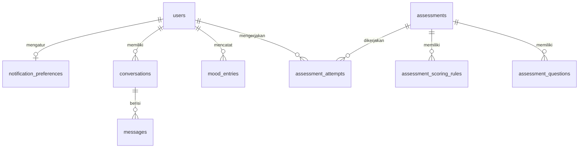

# RelaxBoss - Database Schema
Version: 1.14 | Status: Draft | Last updated: 2026-10-28
Depends on: PRD v1.5, Architecture v1.44 | Owner: Founder (solo developer)

Label: `[Assumption]` bisa diubah. Kedalaman: **Lite**. Segmen pengguna: mahasiswa saja.

Migration ditulis **per task fitur** (lihat `progress.md`), bukan sekaligus. Dokumen ini adalah rancangan tujuan.

---

## 1. Konvensi

| Hal | Aturan |
|---|---|
| Mesin | MySQL 8 atau MariaDB 10.x, `utf8mb4` `[Assumption]` (OQ-A1) |
| Primary key | `id` bigint unsigned auto-increment; pengecualian `conversations.id` (UUID v4, `char(36)`) |
| Nama | Tabel jamak snake_case; kolom snake_case; FK `{singular}_id` |
| Waktu | Disimpan UTC. `mood_entries.entry_date` dihitung WIB lewat `Support/Wib.php` lalu disimpan sebagai `date` |
| Enum | Kolom `string` yang di-cast ke PHP backed enum, bukan tipe `ENUM` database |
| Hapus | Hard delete (FR-019), tanpa `softDeletes`. FK anak `ON DELETE CASCADE` kecuali disebut lain |
| Enkripsi | Kolom bertanda **enc** memakai cast `encrypted` Laravel (ADR-005); disimpan sebagai `text` atau `longtext`, tidak bisa di-query |
| Timestamps | `created_at` dan `updated_at` standar Laravel pada semua tabel kecuali disebut lain |
| Migration | Satu perubahan per file, wajib punya `down()`. Migration yang sudah dijalankan di produksi tidak diubah |

---

## 2. Diagram Relasi

`crisis_events`, `ai_usage_daily`, dan `admin_access_logs` sengaja tidak punya relasi ke identitas pengguna. `articles` berdiri sendiri (konten publik; `related_assessment_slug` merujuk slug Asesmen tanpa foreign key). Tidak ada tabel Intent: daftar intent adalah enum PHP (Architecture bagian 6).

---

## 3. Entitas

### ENT-001 `users`
| Kolom | Tipe | Null | Default | Catatan |
|---|---|---|---|---|
| id | bigint unsigned PK | tidak | | |
| name | varchar(100) | tidak | | Satu kolom nama |
| email | varchar(255) | tidak | | Unik |
| email_verified_at | timestamp | ya | null | |
| password | varchar(255) | tidak | | Hash |
| institution_name | varchar(150) | ya | null | Kampus. Hanya profil, **tidak dikirim ke AI** |
| avatar_updated_at | timestamp | ya | null | Waktu foto profil diperbarui; tidak menyimpan berkas foto di database |
| major | varchar(100) | ya | null | Jurusan. Boleh dikirim ke AI sebagai konteks (FR-015) |
| role | varchar(20) | tidak | `user` | `user` / `admin` |
| is_active | boolean | tidak | true | Dinonaktifkan admin |
| ai_consent_at | timestamp | ya | null | Consent AI (RelaxMate dan Rekomendasi AI) |
| ai_consent_version | smallint unsigned | ya | null | Dibandingkan dengan `config('relaxboss.ai_consent_version')` |
| ai_training_consent_choice | varchar(10) | ya | null | `granted` / `denied`; null = belum ditanya |
| ai_training_consent_at | timestamp | ya | null | Waktu pilihan terakhir |
| ai_training_consent_version | smallint unsigned | ya | null | Versi teks persetujuan pelatihan |
| remember_token | varchar(100) | ya | | |
| created_at, updated_at | timestamp | ya | | |

Indeks: unik `email`; `(role)`; `(created_at)`.
Tidak ada: `gender`, `birth_date`, kolom biner foto profil, `last_active_at`, token Google, kolom pekerja, `softDeletes`. Foto disimpan sebagai berkas terkelola; `avatar_updated_at` hanya metadata cache.

### ENT-002 `assessments`
| Kolom | Tipe | Null | Default | Catatan |
|---|---|---|---|---|
| id | bigint unsigned PK | tidak | | |
| slug | varchar(80) | tidak | | Unik, dipakai di URL |
| name | varchar(150) | tidak | | Nama resmi instrumen |
| display_name | varchar(150) | ya | null | Nama ramah untuk pengguna |
| description | text | tidak | | |
| instructions | text | ya | null | Petunjuk pengerjaan |
| estimated_minutes | tinyint unsigned | tidak | | |
| options | json | tidak | | Pilihan jawaban satu skala untuk semua butir: `[{"value":0,"label":"Tidak Pernah"}, ...]` |
| score_multiplier | decimal(4,2) | tidak | 1.00 | Mis. 2.00 untuk DASS-21 |
| source_reference | varchar(255) | ya | null | Sumber instrumen dan izin (OQ-1) |
| creator_name | varchar(150) | ya | null | |
| creator_institution | varchar(150) | ya | null | |
| validator_name | varchar(150) | ya | null | |
| validator_credential | varchar(150) | ya | null | |
| validated_at | date | ya | null | Status "tervalidasi" diturunkan dari kolom ini |
| is_active | boolean | tidak | false | |
| sort_order | smallint | tidak | 0 | |
| created_at, updated_at | timestamp | ya | | |

Indeks: unik `slug`; `(is_active, sort_order)`.
Tidak ada `target_occupation` dan tidak ada FK ke `users` untuk pembuat atau validator (mereka bukan pengguna).
Instrumen demo memakai slug berawalan `demo-` (pengaman produksi, Architecture bagian 11).

### ENT-003 `assessment_questions`
| Kolom | Tipe | Null | Default | Catatan |
|---|---|---|---|---|
| id | bigint unsigned PK | tidak | | |
| assessment_id | FK `assessments` | tidak | | Cascade |
| position | smallint unsigned | tidak | | Urutan tampil |
| text | varchar(500) | tidak | | |
| sub_scale | varchar(50) | tidak | | Subskala (mis. Depresi, Kecemasan, Stres) |
| is_reversed | boolean | tidak | false | |

Indeks: unik `(assessment_id, position)`.

### ENT-004 `assessment_scoring_rules`
| Kolom | Tipe | Null | Default | Catatan |
|---|---|---|---|---|
| id | bigint unsigned PK | tidak | | |
| assessment_id | FK `assessments` | tidak | | Cascade |
| sub_scale | varchar(50) | tidak | | Sama dengan `assessment_questions.sub_scale` |
| min_score | smallint | tidak | | Inklusif, setelah pengali dan pembalikan skor |
| max_score | smallint | tidak | | Inklusif |
| interpretation | varchar(100) | tidak | | Mis. Normal, Ringan, Tinggi |
| severity_level | varchar(20) | tidak | `normal` | `normal` / `mild` / `moderate` / `severe` |
| trigger_pfa | boolean | tidak | false | Memunculkan pertanyaan konteks |
| pfa_question | text | ya | null | Wajib terisi bila `trigger_pfa` |
| static_recommendation | text | tidak | | Cadangan bila AI gagal atau tanpa consent (FR-010) |

Indeks: `(assessment_id, sub_scale, min_score)`. Validasi aplikasi: per subskala, rentang tidak boleh tumpang tindih dan harus menutup seluruh kemungkinan skor.

### ENT-005 `assessment_attempts`
| Kolom | Tipe | Null | Default | Catatan |
|---|---|---|---|---|
| id | bigint unsigned PK | tidak | | |
| user_id | FK `users` | tidak | | Cascade |
| assessment_id | FK `assessments` | tidak | | Restrict (Asesmen dinonaktifkan, tidak dihapus) |
| answers | longtext | tidak | | **enc**, JSON `{question_id: value}` mentah |
| results | json | tidak | | Snapshot per subskala: `{sub_scale: {score, interpretation, severity_level, trigger_pfa}}`. Tidak dienkripsi demi agregasi |
| user_context | longtext | ya | null | **enc**, JSON `{sub_scale: jawaban}` dari langkah PFA. `null` = belum memutuskan; `[]` = dilewati; objek = jawaban (hanya subskala yang memicu PFA, sekali simpan, maksimal `limits.pfa_answer_max_chars` per jawaban) |
| ai_recommendation | longtext | ya | null | **enc** |
| ai_summary | longtext | ya | null | **enc** |
| completed_at | timestamp | tidak | | Hanya hasil yang selesai disimpan; tanpa status `in_progress` |
| created_at, updated_at | timestamp | ya | | |

Indeks: `(user_id, completed_at)`; `(assessment_id)`.
`results` adalah salinan, jadi perubahan rentang skor oleh admin tidak mengubah riwayat. Teks yang tidak ada di salinan (rekomendasi statis, pertanyaan PFA, batas atas meter) dibaca dari `assessment_scoring_rules` saat ini lewat subskala dan `interpretation`; bila aturan sudah dihapus, bagian itu kosong tetapi hasil tetap terbuka. Statistik agregat dihitung di PHP dari `results`. Tidak ada `psychologist_review`.

### ENT-006 `mood_entries`
| Kolom | Tipe | Null | Default | Catatan |
|---|---|---|---|---|
| id | bigint unsigned PK | tidak | | |
| user_id | FK `users` | tidak | | Cascade |
| mood | tinyint unsigned | tidak | | 1 sampai 5: `sangat_sedih`, `sedih`, `biasa`, `senang`, `luar_biasa` (label dipetakan lewat enum PHP). Tidak dienkripsi |
| arousal_input | varchar(10) | ya | null | `energized` / `tired` |
| note | text | ya | null | **enc**, maks. 500 karakter (divalidasi sebelum enkripsi) |
| entry_date | date | tidak | | Tanggal WIB |
| logged_at | timestamp | tidak | | UTC, waktu mood dicatat |
| created_at, updated_at | timestamp | ya | | |

Indeks: `(user_id, logged_at)`; `(user_id, entry_date)`. Catatan (TASK-013): di SQLite kolom `entry_date` tersimpan sebagai `Y-m-d 00:00:00` (cast `date`), jadi query harian memakai rentang `>= hari ini` dan `< besok`, bukan `=`. **Tidak ada** batas unik per hari: banyak entri per hari diperbolehkan (maks. `limits.mood_per_day`, default 5, divalidasi aplikasi).
Valence dan arousal **tidak disimpan**: dihitung dari `mood` dan `arousal_input` lewat satu konstanta pemetaan di kode. Nilai pemetaannya belum ditentukan dan belum ada yang memakainya; tentukan dan catat di sini saat pertama dibutuhkan (RULE-006).

### ENT-007 `conversations`
| Kolom | Tipe | Null | Default | Catatan |
|---|---|---|---|---|
| id | char(36) PK | tidak | | UUID v4 |
| user_id | FK `users` | tidak | | Cascade |
| status | varchar(20) | tidak | `active` | `active` / `archived` |
| initial_intent | varchar(50) | ya | null | Intent pesan pertama, diisi sekali; kode dari enum `Intent` |
| total_turns | int unsigned | tidak | 0 | 1 turn = satu pesan pengguna + satu balasan |
| has_crisis | boolean | tidak | false | Menentukan banner bantuan permanen |
| last_message_at | timestamp | ya | null | |
| created_at, updated_at | timestamp | ya | | |

Indeks: `(user_id, status)`; `(user_id, last_message_at)`.
Tidak ada judul, ringkasan, mood, platform, atau data riset. Daftar riwayat menampilkan tanggal dan jam dari `created_at`.

### ENT-008 `messages`
| Kolom | Tipe | Null | Default | Catatan |
|---|---|---|---|---|
| id | bigint unsigned PK | tidak | | |
| conversation_id | FK `conversations` | tidak | | Cascade |
| turn_number | smallint unsigned | tidak | | Pengurut pesan. Umumnya ganjil = pengguna, genap = AI, tetapi tidak dijamin setelah balasan AI gagal; `role` yang menentukan peran |
| role | varchar(20) | tidak | | `user` / `assistant` |
| content | text | tidak | | **enc** |
| detected_intent | varchar(50) | ya | null | Hanya pesan AI; kode dari enum `Intent` |
| detection_confidence | decimal(4,4) | ya | null | 0.0000 sampai 0.9999 |
| ai_strategy | varchar(100) | ya | null | Hanya pesan AI |
| ai_flow_action | varchar(100) | ya | null | Hanya pesan AI |
| suggestion_type | varchar(50) | ya | null | `escalate_crisis` / `recommend_professional` / `recommend_support`; null bila tidak ada saran |
| is_crisis | boolean | tidak | false | Pesan pengguna yang memicu Crisis Response, atau balasan Crisis Response |
| created_at | timestamp | ya | | |

Indeks: unik `(conversation_id, turn_number)` (mencegah race condition dan pesan ganda); `(detected_intent, created_at)`.
Tidak ada `user_id` di tabel ini (query lewat pemilik percakapan), tidak ada `client_id`, NER, metadata model, atau info perangkat.

### ENT-009 `crisis_events`
| Kolom | Tipe | Null | Default | Catatan |
|---|---|---|---|---|
| id | bigint unsigned PK | tidak | | |
| layer | varchar(20) | tidak | `rule` | Lapisan pendeteksi: `rule` (chat) atau `pfa_rule` (jawaban PFA Asesmen) |
| created_at | timestamp | tidak | | |

Tanpa `user_id` dan tanpa isi. Hanya untuk hitungan (M-5, FR-025).

### ENT-010 `ai_usage_daily`
| Kolom | Tipe | Null | Default | Catatan |
|---|---|---|---|---|
| id | bigint unsigned PK | tidak | | |
| usage_date | date | tidak | | Tanggal UTC |
| model | varchar(80) | tidak | | |
| feature | varchar(20) | tidak | | `chat` / `assessment` |
| requests | int unsigned | tidak | 0 | |
| rate_limited | int unsigned | tidak | 0 | Jumlah 429 |
| errors | int unsigned | tidak | 0 | Termasuk 401 dan 403 |
| prompt_tokens | bigint unsigned | tidak | 0 | |
| completion_tokens | bigint unsigned | tidak | 0 | |

Indeks: unik `(usage_date, model, feature)`. Dipakai memantau kuota (NFR-011).

### ENT-011 `admin_access_logs`
| Kolom | Tipe | Null | Default | Catatan |
|---|---|---|---|---|
| id | bigint unsigned PK | tidak | | |
| admin_id | FK `users` | ya | null | `ON DELETE SET NULL` |
| resource_type | varchar(30) | tidak | | `conversation` / `assessment_attempt` |
| resource_id | varchar(40) | tidak | | ID internal sumber daya |
| created_at | timestamp | tidak | | |

Mencatat setiap pembukaan isi oleh admin (FR-031). Tidak berisi isi pesan atau identitas pemilik.

**Implementasi (TASK-026):** migration `2026_10_06_000013_create_admin_access_logs_table` (dengan `down()`). `admin_id` `foreignId` nullable ke `users` `ON DELETE SET NULL`; `resource_type` `string(30)` (`conversation` atau `assessment_attempt`); `resource_id` `string(40)` (UUID Percakapan atau ID hasil Asesmen); `created_at` `timestamp` dengan `useCurrent()`; tanpa `updated_at` dan tanpa indeks tambahan. Model `AdminAccessLog` (`UPDATED_AT = null`; konstanta `RESOURCE_CONVERSATION` dan `RESOURCE_ATTEMPT`). Satu baris per pembukaan isi; baris tidak pernah diubah atau dihapus oleh aplikasi.

### ENT-012 `articles`
| Kolom | Tipe | Null | Default | Catatan |
|---|---|---|---|---|
| id | bigint unsigned PK | tidak | | |
| slug | varchar(120) | tidak | | Unik. Artikel contoh berawalan `demo-` |
| title | varchar(150) | tidak | | |
| excerpt | varchar(300) | tidak | | Ringkasan; dipakai di daftar dan sebagai deskripsi bawaan |
| meta_title | varchar(60) | ya | null | Bila kosong: judul dipotong + " \| RelaxBoss" |
| meta_description | varchar(160) | ya | null | Bila kosong: dari `excerpt` |
| body_markdown | longtext | tidak | | Markdown; HTML mentah dibuang saat dirender |
| category | varchar(40) | tidak | | Enum PHP `ArticleCategory` (nilai awal sementara: stres, tidur, kecemasan, burnout) |
| related_assessment_slug | varchar(80) | ya | null | Slug Asesmen terkait, **tanpa FK** |
| author_name | varchar(100) | tidak | | Teks biasa, tanpa relasi ke `users` |
| status | varchar(20) | tidak | `draft` | Enum PHP `ArticleStatus` (`draft`, `published`) |
| published_at | timestamp | ya | null | UTC (RULE-035) |
| created_at, updated_at | timestamp | ya | | |

Indeks: unik `slug`; `(status, published_at)`; `(category, status, published_at)`. Konten publik, jadi **tidak dienkripsi** dan tanpa relasi ke `users`. Hanya artikel `status = published` dengan `published_at <= now()` yang tampil Publik (`Article::published()`; di produksi tambahan: slug bukan `demo-%`).

**Implementasi (TASK-032):** migration `2026_10_19_000014_create_articles_table` (satu berkas, dengan `down()`), model `Article` (cast enum dan `datetime`, scope `published()`, `isDemo()`, relasi `relatedAssessment()` lewat slug), enum `ArticleCategory` dan `ArticleStatus`, `DemoArticleSeeder` (tiga artikel dummy: terbit, draf, terjadwal; hanya lokal; idempotent lewat `updateOrCreate`). Daftar kategori awal bersifat **sementara** dan keputusan konten ada di founder; mengganti kategori cukup mengubah enum tanpa migration, tetapi menghapus case yang masih dipakai baris artikel membuat cast gagal, jadi ubah datanya dulu. Pemeriksaan preflight untuk artikel `demo-` yang terbit menyusul di TASK-035.

### ENT-013 `notification_preferences`
| Kolom | Tipe | Null | Default | Catatan |
|---|---|---|---|---|
| id | bigint unsigned PK | tidak | | |
| user_id | bigint unsigned FK | tidak | | Unik; satu baris per pengguna; `ON DELETE CASCADE` |
| Kolom preferensi lainnya | Sesuai rancangan TASK-044 | | | Daftar kolom rinci tidak disertakan ulang pada catatan Doc Sync 1.75; jangan menebak atau mengubah rancangan TASK-044. |

Indeks unik `user_id`. **Implementasi (TASK-044):** migration `2026_10_28_000017_create_notification_preferences_table`, model `NotificationPreference` dengan `defaults()`, dan relasi `User::notificationPreference()`. Satu baris dibuat saat preferensi pertama kali disimpan; baris terhapus berantai saat akun dihapus. Preferensi bersifat opt-in; pengaturan jam pengingat mood dibatasi 06.00–23.00 WIB.

### ENT-014 `announcements`
| Kolom | Tipe | Null | Default | Catatan |
|---|---|---|---|---|
| id | bigint unsigned PK | tidak | | |
| title | varchar(120) | tidak | | |
| body_markdown | text | tidak | | Dirender dengan `ArticleRenderer`; HTML mentah tidak dipercaya |
| status | varchar(20) | tidak | `draft` | Memakai enum `ArticleStatus` |
| published_at | timestamp | ya | null | UTC |
| created_at, updated_at | timestamp | ya | | |

Indeks `(status, published_at)`. Tidak ada slug. **Implementasi (TASK-045):** migration `2026_10_28_000016_create_announcements_table`, model `Announcement` dengan scope `published()`. Pengumuman dikelola melalui Admin dan dikembalikan ke draf, bukan dihapus permanen.

### Tabel framework
`password_reset_tokens`, `sessions`, `cache`, `cache_locks` (driver `database`). `sessions.user_id` adalah FK nullable ke `users` dengan `ON DELETE CASCADE`, sehingga sesi ikut terhapus saat akun dihapus. Tabel `jobs`, `job_batches`, dan `failed_jobs` **tidak dibuat** (tidak ada queue worker, ADR-006). `personal_access_tokens` (Sanctum) tidak dibuat sampai fase mobile.
Status cooldown API key Groq disimpan di tabel `cache` (tanpa tabel khusus).

**Implementasi (TASK-003):** migration `users`, `password_reset_tokens`, dan `sessions` masing-masing satu berkas (`2026_10_05_00000x`); migration `cache` bawaan skeleton dipertahankan; migration `jobs` bawaan dihapus.

**Implementasi (TASK-008):** empat migration Asesmen, satu berkas per tabel: `2026_10_05_000004_create_assessments_table`, `2026_10_05_000005_create_assessment_questions_table`, `2026_10_05_000006_create_assessment_scoring_rules_table`, `2026_10_05_000007_create_assessment_attempts_table`. `assessment_questions` dan `assessment_scoring_rules` tanpa `created_at` dan `updated_at`. Indeks aturan skor diberi nama `scoring_rules_lookup_index` (nama otomatis terlalu panjang untuk batas MySQL). Pada `assessment_attempts`, kolom `answers`, `user_context`, `ai_recommendation`, dan `ai_summary` bertipe `longText` dan dienkripsi lewat cast model (bukan di migration); `results` bertipe `json`. Enum PHP `SeverityLevel` (`normal`, `mild`, `moderate`, `severe`) dipakai cast `severity_level`. Cast `assessments.score_multiplier` adalah `decimal:2` (string). Relasi pemilik: `User::assessmentAttempts()`.

**Implementasi (TASK-012):** satu migration `2026_10_05_000008_create_mood_entries_table` (dengan `down()`). Kolom sesuai tabel di atas: `mood` `unsignedTinyInteger`, `arousal_input` `string(10)` nullable, `note` `text` nullable (nilai terenkripsi lewat cast model, jauh di bawah batas `text` untuk 500 karakter), `entry_date` `date`, `logged_at` `timestamp`, `timestamps()`; `user_id` FK `ON DELETE CASCADE`; dua indeks `(user_id, logged_at)` dan `(user_id, entry_date)`, tanpa indeks unik. Model `MoodEntry` (cast `mood` ke enum `MoodLevel`, `arousal_input` ke enum `ArousalInput`, `note` `encrypted`, `entry_date` `date`, `logged_at` `datetime`); `user_id` tidak ada di `$fillable` dan diisi lewat relasi `User::moodEntries()` (RULE-033). `MoodLevel` (1 `VerySad` sampai 5 `Great`) punya `label()` (Sangat sedih, Sedih, Biasa, Senang, Luar biasa) dan `key()` (`sangat_sedih` dan seterusnya); `ArousalInput` (`energized`, `tired`) punya `label()` (Bertenaga, Lelah). Batas per hari dan panjang catatan dari `config('relaxboss.limits.mood_per_day')` (5) dan `mood_note_max_chars` (500); penegakannya di TASK-013. `entry_date` hanya dihitung lewat `Wib::date($loggedAt)`, dan `logged_at` harus berupa waktu UTC (Eloquent memformat Carbon apa adanya tanpa konversi, jadi ubah ke `->utc()` sebelum menyimpan).

**Implementasi (TASK-015):** empat migration, satu berkas per tabel: `2026_10_05_000009_create_conversations_table`, `..._000010_create_messages_table`, `..._000011_create_crisis_events_table`, `..._000012_create_ai_usage_daily_table` (semua dengan `down()`). `conversations.id` memakai `uuid('id')->primary()`; `messages.conversation_id` memakai `foreignUuid` dengan `ON DELETE CASCADE`. `messages` hanya punya `created_at` (`Message::UPDATED_AT = null`); `crisis_events` hanya punya `created_at` (default waktu sekarang); `ai_usage_daily` tanpa timestamps. Model `Conversation` (`HasUuids` dengan `newUniqueId()` dikembalikan ke UUID v4 sesuai Schema, bukan v7 bawaan trait; relasi `messages()` terurut `turn_number`), `Message` (`content` terenkripsi; cast `role`, `suggestion_type`, `detection_confidence` `decimal:4`), `CrisisEvent`, `AiUsageDaily` (`$table = 'ai_usage_daily'` karena nama jamak tebakan Laravel berbeda). Enum baru: `ConversationStatus`, `MessageRole`, `SuggestionType`, `CrisisLayer`, `AiFeature`. `detected_intent` dan `initial_intent` tetap `string` sampai enum `Intent` dibuat di TASK-017. Relasi pemilik: `User::conversations()`; `Message` tidak punya `user_id`, pemiliknya dicapai lewat `conversation` (RULE-033). `DemoConversationSeeder` (lokal saja, idempotent): demo-a punya satu percakapan aktif (2 turn) dan satu terarsip (1 turn), demo-b satu percakapan bertanda `[DEMO B]`; tanpa krisis dan tanpa intent. Konstanta batas (`chat_per_day`, `message_max_chars`, `context_max_messages`) sudah ada di `config/relaxboss.php`; penegakannya di TASK-016 sampai TASK-020.

---

## 4. Akses Data

| Entitas | Pemilik | Admin | Catatan |
|---|---|---|---|
| users | Diri sendiri | Daftar terbatas: email, tanggal daftar, verifikasi, aktif | Tidak melihat sandi, consent, jurusan, atau kampus |
| assessments dan turunannya | Baca (aktif) | CRUD | |
| assessment_attempts | Pemilik | Agregat, dan tinjauan **tanpa identitas**: `results`, kategori, `ai_recommendation`, `ai_summary` | Admin **tidak** melihat `answers` dan `user_context` |
| mood_entries | Pemilik | Hanya agregat | Tidak bisa membuka `note` |
| conversations, messages | Pemilik | Tinjauan **tanpa identitas** (hanya baca): isi pesan, intent, `has_crisis` | Tanpa nama, email, ID pengguna, jurusan, kampus; ID semu; hanya tanggal (tanpa jam); setiap pembukaan dicatat di `admin_access_logs` |
| crisis_events, ai_usage_daily | Tidak ada | Baca agregat | |
| admin_access_logs | Tidak ada | Baca | |
| articles | Tidak ada (konten publik) | Buat dan ubah lewat halaman Admin (TASK-034); tanpa hapus | Tidak berkaitan dengan akun pengguna; tidak ikut terhapus saat akun dihapus |

Agregat admin untuk kelompok < 5 orang ditampilkan sebagai "<5". Query admin dilarang memuat relasi ke `users` untuk percakapan dan hasil Asesmen.

---

## 5. Siklus Hidup dan Retensi

| Data | Disimpan | Dihapus |
|---|---|---|
| Profil, hasil Asesmen, Mood Entry, Percakapan | Selama akun aktif | Seketika saat akun dihapus (FR-019): `DELETE users` memicu cascade; sesi ikut dihapus |
| `crisis_events`, `ai_usage_daily`, `admin_access_logs` | Tanpa batas (tanpa identitas) | Tidak perlu |
| Berkas ekspor data AI | Hanya selama dipakai | Dihapus manual oleh founder setelah dipakai. Data yang sudah diekspor **tidak ikut terhapus** saat akun dihapus; ini dijelaskan di halaman Privasi dan teks persetujuan pelatihan |
| Cadangan database | 14 hari `[Assumption]` | Otomatis; data akun yang dihapus masih ada di cadangan sampai masa retensi habis (ditulis jujur di halaman Privasi) |
| Log aplikasi | 14 hari | Otomatis; tidak berisi data pribadi |

**Hapus akun (API-016):** satu transaksi; ditolak bila pengguna adalah admin terakhir.
**Reset sandi (API-005):** mengganti `users.password` dan `remember_token`, serta menghapus semua baris `sessions` pengguna itu. `password_reset_tokens` menyimpan token ber-hash, satu baris per email.
**Pemulihan data terenkripsi:** salin `APP_KEY` terpisah dari cadangan database.

---

## 6. Seed dan Data Awal

Sebelum task hosting (TASK-031), semua data berupa **data dummy**. Data nyata dibahas di TASK-030.

| Seeder | Isi | Lingkungan |
|---|---|---|
| `AdminSeeder` | Satu admin dari `ADMIN_SEED_EMAIL` dan `ADMIN_SEED_PASSWORD` (dibaca lewat `config('relaxboss.admin_seed')`). Hanya membuat bila belum ada (tidak menimpa sandi); berhenti dengan pesan bila kosong atau sandi kurang dari 8 karakter | Semua |
| `DemoAccountSeeder` | Empat akun dummy `example.test` bersandi `password`: `demo-a` dan `demo-b` (aktif, terverifikasi; untuk uji isolasi data), `demo-unverified`, `demo-inactive`. Dilewati di luar `local` | Lokal saja |
| `DemoAssessmentSeeder` | Instrumen contoh `demo-stres-harian` (dummy, teks dibuat sendiri): 12 butir, tiga subskala (Stres, Kecemasan, Kelelahan), satu butir terbalik (nomor 10), pengali 2.00, opsi 0 sampai 3, empat aturan skor per subskala yang menutup rentang 0..30, 0..24, dan 0..18 tanpa celah, PFA pada tingkat Tinggi untuk Stres dan Kecemasan. Idempotent (`updateOrCreate`). Dipanggil dari `DatabaseSeeder` | Lokal saja |
| `DemoConversationSeeder` | Dua percakapan dummy `demo-a` (aktif dan terarsip) dan satu `demo-b` (bertanda `[DEMO B]`), isi bertanda `[DEMO]`, tanpa krisis. Idempotent: percakapan akun demo dihapus lalu dibuat ulang. Dilewati di luar `local` | Lokal saja |
| `DemoMoodSeeder` | Catatan mood dummy: `demo-a` 30 hari terakhir (pola mood bervariasi, beberapa hari punya 2 atau 3 entri dengan jam berbeda, sebagian berisi tenaga dan catatan `[DEMO]`), `demo-b` 3 entri bercatatan `[DEMO B]` (untuk uji isolasi data). Entri di masa depan dilewati. Idempotent: catatan mood akun demo dihapus lalu dibuat ulang. Dilewati di luar `local` | Lokal saja |
| `DemoArticleSeeder` | Tiga artikel dummy berslug `demo-` (terbit, draf, terjadwal) dengan isi bertanda `[DEMO]`, termasuk HTML mentah untuk menguji sanitasi. Dilewati di luar `local`. Artikel asli ditulis founder sebelum go-live | Lokal |
| Instrumen asli | Dimasukkan lewat panel admin pada TASK-030 setelah sumber dan izinnya jelas (OQ-1) | Produksi |

Data lama (file SQL sebelumnya) tidak diimpor; produk dimulai kosong.

---

### Konten artikel (TASK-037)
`ArticleContentSeeder` mengisi 25 artikel asli, kategori stres (7), tidur (5), kecemasan (7), dan burnout (6). Jalankan secara eksplisit dengan `php artisan db:seed --class=ArticleContentSeeder --force`; seeder bukan bagian otomatis `DatabaseSeeder`. Seeder menggunakan slug untuk upsert dan menyimpan referensi sumber di isi artikel. Jangan jalankan sebelum backup pada hosting.

---

## 7. Pola Query Penting

| Kebutuhan | Query | Indeks |
|---|---|---|
| Riwayat Asesmen pengguna | `attempts WHERE user_id ORDER BY completed_at DESC` | `(user_id, completed_at)` |
| Grafik mood | `mood_entries WHERE user_id AND entry_date BETWEEN ...`, rata-rata per hari dihitung di kode | `(user_id, entry_date)` |
| Daftar Percakapan | `conversations WHERE user_id ORDER BY last_message_at DESC` | `(user_id, last_message_at)` |
| Konteks chat | 10 pesan terakhir per Percakapan, urut `turn_number` | unik `(conversation_id, turn_number)` |
| M-1 aktivasi | `users` join `assessment_attempts` dalam 7 hari sejak `created_at` | `(user_id, completed_at)` |
| M-2 retensi | Hitung `entry_date` berbeda per pengguna dalam 14 hari | `(user_id, entry_date)` |
| M-3 adopsi RelaxMate | Pengguna dengan `conversations` dalam 14 hari | `(user_id, last_message_at)` |
| Statistik kategori | Dihitung di PHP dari `assessment_attempts.results` | `(assessment_id)` |
| Monitoring intent rendah | `messages WHERE detection_confidence < batas` tanpa join `users` | `(detected_intent, created_at)` |

---

## Assumptions
- A-1: MySQL 8 atau MariaDB 10.x dengan `utf8mb4`.
- A-2: Volume kecil (puluhan sampai ratusan pengguna); tanpa partisi atau arsip.
- A-3: Perilaku pembalikan skor (`is_reversed`) dan batas rentang divalidasi per Instrumen asli saat TASK-030.
- A-4: Satu skala jawaban per Instrumen (`assessments.options`), berlaku untuk semua butir.

## Open Questions
OQ-1 (sumber dan izin Instrumen asli, termasuk memeriksa perilaku pembalikan skor MBI) dan OQ-A1 (versi database). Rinciannya di PRD dan Architecture.

## Change Log

| Versi | Tanggal | Ringkasan |
|---|---|---|
| 1.14 | 2026-10-28 | ENT-013 preferensi notifikasi dan ENT-014 pengumuman; migration dan model dicatat. |
| 1.13 | 2026-10-28 | ENT-014 `announcements` tanpa slug, status draf/terbit, indeks status dan waktu terbit. |
| 1.12 | 2026-10-27 | ENT-001 `avatar_updated_at`; seed artikel asli dicatat pada bagian 6. |
| 1.11 | 2026-10-20 | ENT-012 dan implementasi tabel artikel. |
| 1.3–1.10 | 2026-10-05–20 | Implementasi tabel inti, consent, monitoring, dan ekspor; tidak ada perubahan skema pada beberapa revisi. |
| 1.0–1.2 | 2026-10-04 | Skema dirancang ulang untuk mahasiswa, Asesmen, Mood, RelaxMate, dan privasi. |
